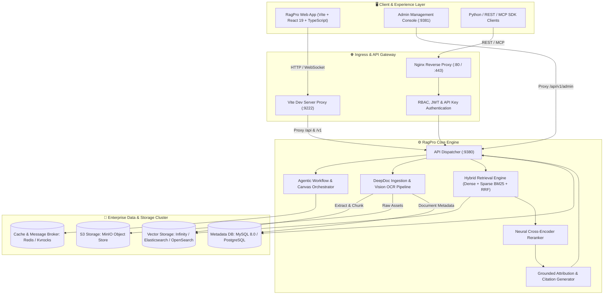

# RagPro - Next-Generation Enterprise Retrieval & Intelligence Platform

<div align="center">


### **The Production-Grade Retrieval-Augmented Generation & Multi-Agent Intelligence Engine**

[](https://vitejs.dev/)
[](https://www.docker.com/)
[](https://github.com/infiniflow/infinity)
[](https://www.python.org/)
[](LICENSE)

[Architecture](#-system-architecture) • [Key Capabilities](#-core-capabilities) • [Quickstart](#-quickstart--deployment) • [Configuration](#-configuration-reference) • [API Contract](#-api--integration-contract) • [Project Layout](#-project-structure)

</div>

---

## 📌 Executive Summary

**RagPro** is an enterprise-grade **Retrieval-Augmented Generation (RAG)** and **Autonomous Agentic Workflow** platform built for complex, mission-critical document understanding and conversational intelligence. 

Traditional RAG implementations rely on naive chunking (fixed token splits) and basic top-k vector similarity, which inevitably fail on complex enterprise documents containing nested tables, multi-column layouts, figures, and hierarchical structures. 

**RagPro** overcomes these limitations through:
1. **DeepDoc Layout Engine**: Deep-learning OCR, table boundary recognition, and structure-aware hierarchical parsing.
2. **Multi-Stage Hybrid Search**: Dense semantic vector retrieval + Sparse BM25 keyword matching fused with Reciprocal Rank Fusion (RRF) and neural cross-encoder reranking.
3. **Visual Agentic Workflow Canvas**: A drag-and-drop pipeline composer for multi-agent logic, knowledge retrieval, and tool execution.
4. **Production Docker Deployment**: Full container orchestration encompassing live vector engines, relational metadata, distributed object storage, and real-time API services.

---

## 🏗️ System Architecture



---

## 🚀 Core Capabilities

### 1. Vision & Structure-Aware Deep Document Understanding (DeepDoc)
* **Vision OCR & Layout Analysis**: Recognizes document layouts across complex multi-column PDFs, scientific papers, financial balance sheets, scanned TIFFs, and presentation slides.
* **Intelligent Table Extraction**: Preserves relational spreadsheet and table structures as clean HTML tables or JSON records, rather than disordered raw text fragments.
* **Hierarchical Chunking**: Respects document chapters, sections, headers, and semantic boundaries to retain contextual coherence.

### 2. Multi-Stage Hybrid Retrieval & Neural Reranking
* **Dense Semantic Embeddings**: Supports HuggingFace, OpenAI, Cohere, Jina, VoyageAI, and local Ollama embedding models.
* **Sparse BM25 Indexing**: Keyword matching optimized for domain-specific acronyms, product SKUs, and exact nomenclature.
* **Reciprocal Rank Fusion (RRF)**: Mathematically merges dense vector proximity with sparse keyword relevance.
* **Neural Cross-Encoder Reranking**: Re-evaluates top candidate chunks with cross-attention models to achieve maximal NDCG@K and eliminate irrelevant noise.

### 3. Agentic Workflow Canvas & Visual DSL
* **Modular Node Canvas**: Connect LLMs, Knowledge Retrieval, Web Search, DuckDuckGo, Python code executors, and API webhooks on an interactive canvas.
* **Model Context Protocol (MCP)**: Native integration for MCP servers, exposing RagPro datasets directly as tools to external agents.
* **Multi-Turn Memory Management**: Sliding window buffer and semantic summary memory components for coherent long-running agent chats.

### 4. Enterprise-Ready Multi-Tenancy & Governance
* **Strict Tenant Isolation**: Distinct workspaces, permissions, and dataset scoping.
* **Audit Trails & Execution Logs**: Full observability into query latencies, token consumption, retrieval scores, and ingestion tasks.
* **Production Docker Stack**: Containerized deployment with high-availability vector stores and persistent volumes.

---

## ⚡ Quickstart & Deployment

### Prerequisites
* **Docker & Docker Compose**: Docker Desktop 4.x+ (WSL 2 on Windows or native Linux Docker daemon)
* **Node.js**: v20+ or v22+
* **RAM**: Minimum 8GB (16GB+ recommended for local OCR models and vector databases)

---

### Step 1: Launch Backend Cluster (Docker)

Use the automated PowerShell launcher (Windows) or standard Docker Compose:

```powershell
# Using the Windows PowerShell Launcher
.\start-ragpro.ps1 backend

# OR via standard Docker Compose command
cd docker
docker compose up -d
```

Verify backend services are running:
* **API Service**: `http://localhost:9380`
* **Admin Server**: `http://localhost:9381`
* **Elasticsearch / Infinity**: `http://localhost:9200`
* **MinIO Console**: `http://localhost:9001`

---

### Step 2: Start RagPro Web Dashboard (Vite Frontend)

The frontend is configured to proxy all API requests to the live backend services:

```powershell
# Using the Windows PowerShell Launcher
.\start-ragpro.ps1 frontend

# OR manually navigate to web directory
cd web
npm install --legacy-peer-deps
npm run dev
```

The web console will be accessible at:
👉 **`http://localhost:9222`**

---

## ⚙️ Configuration Reference

### Docker Environment (`docker/.env`)
| Variable | Default Value | Description |
| :--- | :--- | :--- |
| `DOC_ENGINE` | `elasticsearch` | Vector engine: `elasticsearch`, `infinity`, `opensearch` |
| `DEVICE` | `cpu` | Inference accelerator: `cpu` or `gpu` |
| `SVR_HTTP_PORT` | `9380` | Port for the core RagPro Go/Python API server |
| `ADMIN_SVR_HTTP_PORT` | `9381` | Port for the RagPro Admin server |
| `SVR_WEB_HTTP_PORT` | `80` | Production HTTP port for bundled Nginx |
| `MYSQL_PASSWORD` | `infini_rag_flow` | Root password for MySQL relational metadata |
| `ELASTIC_PASSWORD` | `infini_rag_flow` | Elasticsearch cluster administrative password |

### Web Client Environment (`web/.env`)
| Variable | Value | Description |
| :--- | :--- | :--- |
| `PORT` | `9222` | Local Vite dev server port |
| `VITE_DEFAULT_LANGUAGE_CODE` | `en` | Default UI localization (`en`, `zh`, `ja`, etc.) |

---

## 🔌 API & Integration Contract

### Core Endpoints

#### 1. System Health & Status
```http
GET /v1/system/version
```
**Response:**
```json
{
  "code": 0,
  "data": {
    "version": "RagPro-v1.0.0",
    "status": "healthy"
  }
}
```

#### 2. Hybrid Retrieval Execution
```http
POST /v1/api/retrieval
Content-Type: application/json
Authorization: Bearer <RAGPRO_API_KEY>

{
  "dataset_ids": ["ds_7f8a9b2c"],
  "question": "What are the Q3 fiscal compliance metrics?",
  "similarity_threshold": 0.2,
  "vector_similarity_weight": 0.7,
  "top_k": 10,
  "rerank_id": "bge-reranker-large"
}
```

#### 3. Agentic Workflow Execution
```http
POST /v1/api/canvas/execute
Content-Type: application/json
Authorization: Bearer <RAGPRO_API_KEY>

{
  "canvas_id": "cvs_819203",
  "inputs": {
    "query": "Synthesize the risk summary from uploaded PDFs"
  }
}
```

---

## 📁 Project Structure

```plaintext
RagPro/
├── docker/                     # Docker Compose deployment & environment files
│   ├── docker-compose.yml       # Production services composition
│   ├── docker-compose-base.yml  # Base cluster services (ES, MySQL, MinIO, Redis)
│   ├── .env                    # Docker orchestration variables
│   └── service_conf.yaml.template
├── conf/                       # Core service configurations & model mappings
│   ├── service_conf.yaml       # Backend service connection endpoints
│   └── all_models.json         # Supported LLM, Embedding, and Reranking models
├── web/                        # RagPro Web Dashboard (Vite + React + TypeScript)
│   ├── public/                 # Static assets (logo.svg, icons, fonts)
│   ├── src/
│   │   ├── components/         # Shared UI components (RagPro avatars, tables, dialogs)
│   │   ├── layouts/            # Navbar, header, and global application shells
│   │   ├── pages/              # Portal pages (Datasets, Chats, Canvas, Admin, Login)
│   │   ├── conf.json           # Application branding ("RagPro")
│   │   └── routes.tsx          # Client routing table
│   ├── vite.config.ts          # Vite configuration with live backend proxy
│   └── package.json            # Frontend dependency specifications
├── start-ragpro.ps1            # Windows PowerShell orchestrator & launcher
├── start-ragpro.sh             # Linux / macOS Bash orchestrator & launcher
└── README.md                   # Comprehensive platform documentation
```

---

## 🛡️ License

RagPro is open-source software licensed under the [Apache License 2.0](LICENSE).
